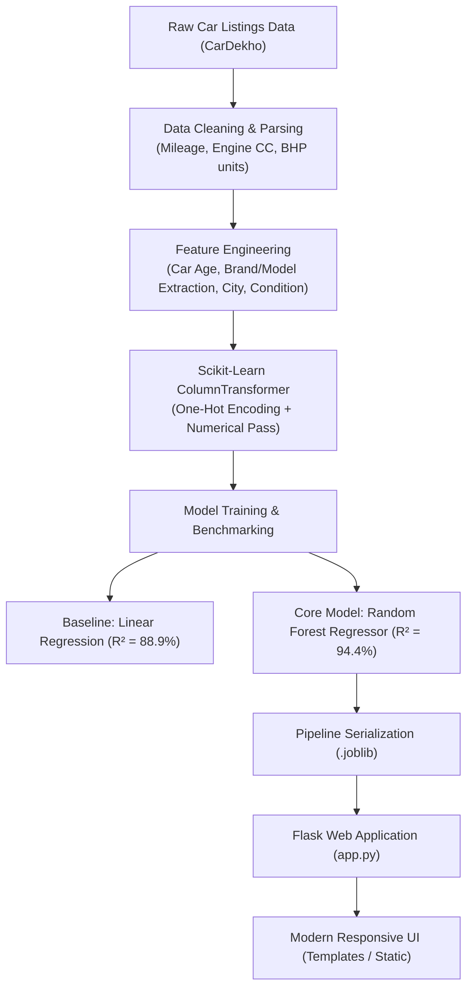

# Car Resale Value Prediction 

Built with **Python**, **Flask**, **Scikit-Learn**, and **Bootstrap 5**.

---

## 📌 1. Project Overview & Motivation
Determining the accurate resale value of a used car is challenging due to the complex interplay of several factors:
* Vehicle age and annual depreciation rates
* Total mileage and usage intensity
* Fuel type (Diesel vs. Petrol vs. CNG)
* Geographic location and demand in metro vs. non-metro cities
* Mechanical and physical condition
* Brand retention in the Indian secondary market

This project uses authentic Indian automobile market data (8,000+ listings) to build a machine learning model that accurately estimates fair market price along with an upper and lower fair valuation range.

---

## 🏗️ 2. System Architecture



---

## 📁 3. Project Directory Structure

```text
├── data/
│   └── car_data.csv                  # Processed authentic automobile dataset (8,110 rows)
├── models/
│   ├── car_price_pipeline.joblib     # Serialized Scikit-Learn Random Forest pipeline
│   ├── metrics.json                  # Model benchmark metrics and categorical metadata
│   └── specs_lookup.joblib           # Precomputed brand/model median technical specifications
├── static/
│   ├── css/
│   │   └── style.css                 # Custom styling, CarDekho branding, responsiveness
│   └── js/
│       └── main.js                   # Dynamic dropdowns, auto-fill specs, and AJAX valuation
├── templates/
│   └── index.html                    # Flask Jinja2 interactive valuation dashboard
├── app.py                            # Flask web application & REST API routes
├── app_streamlit.py                  # Legacy Streamlit interface (backup reference)
├── prepare_data.py                   # Data cleaning, unit parsing & feature engineering script
├── train.py                          # ML model training, benchmarking & serialization
├── test_app.py                       # Automated test suite for Flask endpoints & ML inference
├── requirements.txt                  # Python dependencies (Flask, Scikit-learn, Pandas, etc.)
└── README.md                         # Complete project documentation & viva examination guide
```

---

## 📊 4. Dataset Description
The dataset contains **8,110 cleaned car listings** across popular Indian automobile brands (Maruti, Hyundai, Honda, Toyota, Mahindra, Tata, Ford, etc.).

| Feature | Type | Description |
| :--- | :--- | :--- |
| `brand` | Categorical | Manufacturer Make (Maruti, Hyundai, Honda, Toyota, etc.) |
| `model` | Categorical | Car Model (Swift, City, Innova, i20, etc.) |
| `year` / `car_age` | Numerical | Manufacturing Year & Derived Age (`2026 - Year`) |
| `km_driven` | Numerical | Total kilometers logged on odometer |
| `fuel` | Categorical | Petrol, Diesel, CNG, LPG |
| `transmission` | Categorical | Manual or Automatic |
| `owner` | Categorical | First Owner, Second Owner, Third Owner, Fourth & Above |
| `city` | Categorical | Major Indian cities (Delhi, Mumbai, Bangalore, Pune, etc.) |
| `condition` | Categorical | Physical & mechanical rating (Excellent, Good, Fair) |
| `mileage_kmpl` | Numerical | Fuel efficiency in kmpl |
| `engine_cc` | Numerical | Engine displacement volume (CC) |
| `max_power_bhp` | Numerical | Maximum engine power output (BHP) |
| `seats` | Numerical | Seating capacity (4 to 8 seats) |
| **`selling_price`** | **Numerical** | **Target variable: Selling price in Indian Rupees (₹)** |

---

## ⚙️ 5. Data Preprocessing & Feature Engineering
1. **Unit Parsing**: Removed non-numeric units from raw strings (e.g., `"23.4 kmpl"` $\rightarrow$ `23.4`, `"1197 CC"` $\rightarrow$ `1197`, `"82 bhp"` $\rightarrow$ `82.0`).
2. **Median Imputation**: Imputed missing technical specifications using **brand-specific medians** to maintain realistic car specifications.
3. **Outlier Filtering**: Removed anomalous entries with price $\le$ ₹25,000 or kilometers driven $\le$ 500 km.
4. **Car Age Transformation**: Computed `car_age = 2026 - year`. Age directly correlates with wear and market depreciation.
5. **ColumnTransformer Pipeline**: Bundled One-Hot Encoding for categorical features (`handle_unknown='ignore'`) and numerical passthrough directly into the estimator pipeline to prevent data leakage.

---

## 🧠 6. Machine Learning Models & Evaluation

Two regression algorithms were evaluated on an **80/20 train-test split** (6,488 training samples, 1,622 test samples):

### 6.1 Baseline: Linear Regression
* Assumes a constant linear relationship between features and price.
* Shows decent linear correlation, but struggles with non-linear vehicle depreciation curves.

### 6.2 Recommended Model: Random Forest Regressor
* Ensemble of **100 Decision Trees** with bootstrap aggregation (bagging).
* Naturally models complex non-linear interactions (e.g., Automatic transmission has a higher price premium in luxury SUVs than in entry-level hatchbacks).
* Resistant to outliers and handles high-cardinality brand combinations effectively.

### 6.3 Comparative Performance Results

| Metric | Linear Regression | Random Forest Regressor | Improvement |
| :--- | :---: | :---: | :---: |
| **$R^2$ Score (Accuracy)** | **0.8894** (88.9%) | **0.9439** (94.4%) | **+ 5.5% Higher Variance Explained** |
| **Mean Absolute Error (MAE)** | ₹ 1,36,774 | **₹ 75,058** | **~46% Lower Error** |
| **Root Mean Squared Error (RMSE)**| ₹ 2,93,177 | **₹ 2,08,831** | **~29% Lower Error** |
| **Mean Absolute % Error (MAPE)** | 32.69% | **15.88%** | **Over 2x Better Percentage Precision** |

---

## 💻 7. How to Run the Project

### Step 1: Install Dependencies
Ensure you have Python 3.9+ installed, then install required packages:
```bash
pip install -r requirements.txt
```

### Step 2: (Optional) Retrain Model
The repository already includes the pre-trained model. To retrain from scratch:
```bash
python train.py
```
This will train the models, display the metrics comparison table, and serialize the pipeline into `models/car_price_pipeline.joblib`.

### Step 3: Run the Test Suite
Verify that all Flask routes and the ML pipeline work correctly:
```bash
python test_app.py
```

### Step 4: Launch the Flask Web Application
Start the Flask web server:
```bash
python app.py
```
Open your web browser and navigate to:
```
http://127.0.0.1:5000
```

---

## 🌐 8. Web Application Endpoints & REST API

The Flask application provides both web interfaces and JSON REST APIs:

| Endpoint | Method | Description |
| :--- | :---: | :--- |
| `/` | `GET` | Main interactive car resale valuation dashboard |
| `/api/models?brand=<brand>` | `GET` | Returns list of models available for the selected brand |
| `/api/specs?brand=<brand>&model=<model>` | `GET` | Returns default technical specs (mileage, CC, BHP, seats) |
| `/predict` | `POST` | Computes price valuation and market insights (supports both JSON payload and standard Form POST) |

---

## 🎯 9. Web Application Features
* **Dynamic Brand & Model Filtering**: Selecting a Brand (e.g. Maruti, Hyundai, Honda) immediately updates the car models dropdown via asynchronous API fetch.
* **Auto-Filled Technical Specs**: Automatically populates median engine CC, mileage, power, and seating capacity for chosen cars, with expandable controls to fine-tune.
* **Smart Odometer Quick-Select**: Single-click odometer chip presets (25k, 45k, 75k, 120k).
* **Valuation Display**: Shows estimated fair market value in Indian numbering format (e.g., **₹ 6.83 Lakh**).
* **Fair Price Range**: Computes an upper and lower fair valuation range (±6%) to mirror real-world inspection variations.
* **Vehicle Usage Insights**: Evaluates average annual kilometers (`km_driven / age`) and tags usage intensity (Normal vs. High).
* **Academic Metrics Modal**: In-app pop-up showing R² score, MAE, RMSE, MAPE, and baseline comparison table for project viva / oral exams.

---

## 🎓 10. College Viva / Oral Examination Q&A

**Q1: Why did you choose Random Forest over Linear Regression?**
> *Answer:* Car depreciation is non-linear—a car loses 15-20% of its value in Year 1, but only 4-5% per year after Year 5. Linear regression assumes a fixed straight-line drop. Random Forest uses an ensemble of decision trees that easily capture non-linear patterns and feature interactions, cutting MAE by ~46%.

**Q2: How did you prevent Data Leakage?**
> *Answer:* We used Scikit-Learn's `Pipeline` and `ColumnTransformer`. All transformations (such as One-Hot Encoding and handling unknown categories) are fitted strictly on the training fold and only transformed on the test fold.

**Q3: What does the $R^2$ score of 0.9439 mean?**
> *Answer:* It means 94.39% of the variance in used car selling prices is explained by our model's input features (age, kilometers, brand, fuel, condition, city, and engine specs).

**Q4: How does the model handle an unseen car brand or category?**
> *Answer:* The `OneHotEncoder` is initialized with `handle_unknown='ignore'`. If an unseen category appears during inference, it assigns zeros to one-hot columns without throwing a runtime error.
